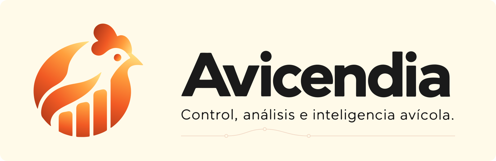

<picture>
  <source media="(max-width: 600px) and (prefers-color-scheme: dark) and (prefers-reduced-motion: no-preference)" srcset="assets/branding/readme/hero-motion-compact-dark.gif" type="image/gif">
  <source media="(max-width: 600px) and (prefers-reduced-motion: no-preference)" srcset="assets/branding/readme/hero-motion-compact-light.gif" type="image/gif">
  <source media="(prefers-color-scheme: dark) and (prefers-reduced-motion: no-preference)" srcset="assets/branding/readme/hero-motion-dark.gif" type="image/gif">
  <source media="(prefers-reduced-motion: no-preference)" srcset="assets/branding/readme/hero-motion-light.gif" type="image/gif">
  <source media="(max-width: 600px) and (prefers-color-scheme: dark)" srcset="assets/branding/readme/hero-compact-dark.svg">
  <source media="(max-width: 600px)" srcset="assets/branding/readme/hero-compact-light.svg">
  <source media="(prefers-color-scheme: dark)" srcset="assets/branding/readme/hero-dark.svg">
  <source media="(prefers-color-scheme: light)" srcset="assets/branding/readme/hero-light.svg">
  
</picture>

# Avicendia

Entender lo que pasa en la granja empieza por tener buenos registros.

Avicendia es una plataforma en desarrollo para granjas de pollos de engorde. Queremos que preparar, revisar y consultar el reporte diario sea más sencillo, reuniendo la información de cartillas, hojas de cálculo y mensajes sin perder su origen ni sus correcciones.

> **Estamos dando forma al producto.** Por ahora, aquí encontrarás documentación y ejemplos inventados para explorar cómo debería funcionar Avicendia. Todavía no hay una aplicación para instalar ni una versión comercial disponible.

[Propósito](#propósito) · [Disponible hoy](#disponible-hoy) · [Capacidades previstas](#capacidades-previstas) · [Documentación](#documentación) · [Desarrollo](#desarrollo-y-calidad)

## Propósito

Una cifra resulta mucho más útil cuando sabemos de dónde viene, a qué galpón y campaña corresponde y si alguien la revisó. Esa es la base sobre la que queremos construir Avicendia:

- **Registros que se puedan seguir:** conservar la fecha, la unidad, la fuente y quién aportó cada dato. Si falta información, debe quedar claro; un espacio vacío no significa cero.
- **Información que ayude a comprender:** consultar antecedentes y reconocer cambios en la producción, con acceso a los registros que los explican.
- **Revisión antes de decidir:** saber qué llegó, qué se corrigió y qué está confirmado antes de usar esa información en indicadores o recomendaciones.

Pensamos en quienes registran y revisan la producción cada día: operarios, encargados, veterinarios y administradores. El trabajo de campo tendrá que ayudarnos a comprobar qué necesitan y si esta propuesta les resulta útil. Puedes conocer el punto de partida en la [tesis de producto](docs/00-producto/TESIS_PRODUCTO.md).

## Disponible hoy

Hoy puedes recorrer la documentación que estamos preparando antes de construir la aplicación:

- La idea del producto y el perfil de las personas a quienes podría servir.
- Una guía y un formato para futuras entrevistas.
- El flujo diario propuesto, un glosario y la descripción de los campos del reporte.
- Un caso completamente inventado, acompañado de un JSON para explorar los datos.

Estos documentos son propuestas de trabajo: todavía necesitan revisión y contraste en campo. El repositorio aún no contiene la aplicación ni una arquitectura de software implementada.

## Capacidades previstas

Estas son las capacidades que nos proponemos desarrollar. Todas están **planificadas**:

| Capacidad prevista | Resultado buscado |
|---|---|
| Registro productivo | Organizar población, alimento, agua y mediciones por contexto productivo |
| Revisión y trazabilidad | Conservar fuentes, responsables, faltantes y correcciones |
| Consulta y analítica | Elaborar reportes e indicadores con datos suficientes y revisados |
| Captura asistida e IA | Ayudar a interpretar documentos y preparar información para revisión |
| Integraciones | Evaluar mensajería e instrumentos de medición de forma progresiva |

La captura de documentos con OCR, WhatsApp, la IA predictiva y los sensores forman parte de lo que queremos explorar; aún no hay integraciones operativas. Cada incorporación necesitará pruebas y revisión. En particular, un dato extraído automáticamente deberá distinguirse de uno confirmado.

## Documentación

| Para explorar | Referencias |
|---|---|
| Producto y público | [Tesis](docs/00-producto/TESIS_PRODUCTO.md) · [Cliente ideal hipotético](docs/00-producto/CLIENTE_IDEAL.md) |
| Investigación pendiente | [Guía de entrevistas](docs/00-producto/GUIA_ENTREVISTAS_CAMPO.md) · [Formato vacío](docs/00-producto/FORMATO_ENTREVISTA.md) |
| Operación y lenguaje | [Flujo diario](docs/00-producto/FLUJO_DIARIO_PRODUCCION.md) · [Glosario](docs/00-producto/GLOSARIO_DOMINIO.md) · [Fuentes posibles](docs/00-producto/INVENTARIO_CARTILLAS_MENSAJES.md) |
| Datos del reporte | [Diccionario funcional](docs/00-producto/DICCIONARIO_REPORTE_DIARIO.md) |
| Ejemplo inventado | [Caso sintético](docs/00-producto/EJEMPLO_OPERATIVO_G06.md) · [JSON sintético](docs/00-producto/fixtures/G06_SINTETICO.json) |
| Entregas y evidencia | [Reportes de tareas](docs/reportes/) · [Contrato de CG-001](docs/00-producto/CG-001.md) |

### Evolución del proyecto

Avanzamos por entregas identificadas como `CG-###`. En [los reportes](docs/reportes/) dejamos constancia de lo que se hizo, cómo se comprobó y qué queda pendiente. Integrar una entrega en `main` y aceptar su resultado son pasos distintos.

**Progreso pendiente de consolidación.** Antes de mostrar un porcentaje, necesitamos reunir las aceptaciones y resolver las diferencias entre los estados históricos de los reportes. Mientras tanto, cada documento permite revisar el alcance real de su entrega. El plan detallado de ingeniería se mantiene en el entorno local.

## Desarrollo y calidad

Si vas a trabajar en el proyecto, empieza por [las instrucciones de trabajo](AGENTS.md) y [la política de publicación](docs/PUBLICACION.md). Cada tarea parte de `main`, se prepara en una rama `codex/CG-###-descripcion` y se acompaña de las comprobaciones que necesita. Los cambios transversales, como esta portada, pueden tener un identificador propio.

Al construir la aplicación, cuidaremos que cada persona acceda solo a las empresas y recursos autorizados, que los datos faltantes sigan siendo visibles y que la información extraída automáticamente pase por la revisión correspondiente. Son compromisos de diseño que aún deben llevarse al software y comprobarse.

Para los ejemplos públicos usamos datos inventados y los identificamos como tales. Las credenciales, conversaciones, ubicaciones operativas, fórmulas privadas y datos de clientes deben permanecer fuera de los archivos y del historial que se publique.

Por ahora revisamos el contenido, los enlaces y los activos de cada entrega documental. Cuando haya una aplicación ejecutable, aquí encontrarás cómo instalarla y probarla. La [guía de mantenimiento](docs/README_MAINTENIMIENTO.md) explica cómo mantener esta portada al día.

## Marca y uso

**Avicendia · Control, análisis e inteligencia avícola.** La [guía de activos](docs/brand/ASSETS.md) reúne los colores, las variantes y las decisiones de marca que siguen en revisión.

El repositorio todavía no tiene una licencia de código o de marca. Los permisos de reutilización deben acordarse con el propietario, aunque el contenido pueda consultarse públicamente.
