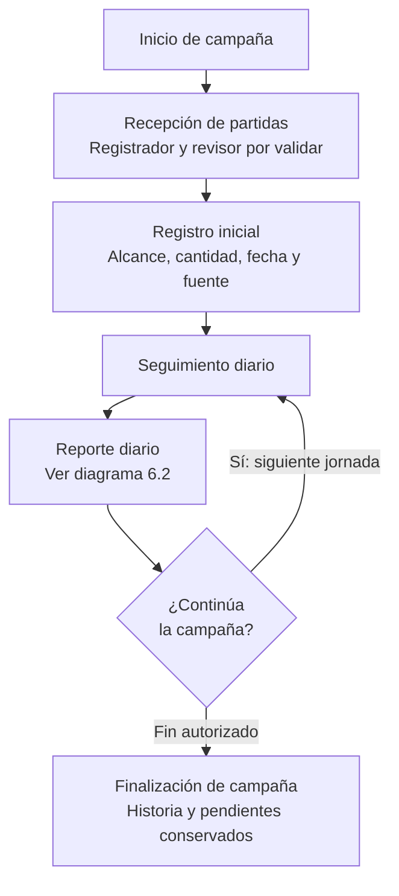
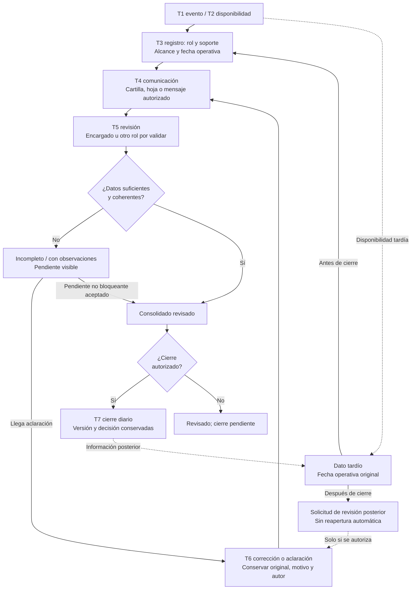

# Avicendia — Flujo diario de producción

CG-005 · 16 de octubre de 2026 · **Modelo operativo preliminar, sujeto a validación de campo.**

## 1. Objetivo y límites

Describir cómo podría generarse, registrarse, comunicarse, revisarse y consolidarse información de una campaña de pollos de engorde, desde la recepción de aves hasta el reporte diario y la eventual finalización de campaña. No hay entrevistas ni observaciones verificadas que certifiquen este flujo para una granja específica. Ninguna asignación de responsabilidades, horario o condición de cierre se presenta como confirmada.

El documento es una referencia de análisis. No define base de datos, sincronización, endpoints, frecuencias sanitarias, umbrales ni una máquina de estados implementable. Los formularios e integraciones de Avicendia son capacidades futuras, no soportes disponibles.

## 2. Fuentes documentales y supuestos

- [CG-002 — Tesis de producto](TESIS_PRODUCTO.md): reportes, calidad de datos, consulta histórica y métricas todavía por medir.
- [CG-003 — Cliente ideal hipotético](CLIENTE_IDEAL.md): diversidad de soportes y conectividad; P2 es una prioridad provisional, no un cliente validado.
- [CG-004 — Guía](GUIA_ENTREVISTAS_CAMPO.md) y [formato vacío](FORMATO_ENTREVISTA.md): preguntas para contrastar actores, secuencia temporal e incidentes; no contienen resultados de entrevistas.

Se supone únicamente, para modelar, que las funciones pueden repartirse o coincidir en una persona. Campaña es el ciclo temporal; galpón y sección son ámbitos físicos. Una campaña puede tener varias partidas de ingreso y recepciones en fechas distintas; partida no equivale a campaña ni sección. La existencia y denominación de cada nivel deberán comprobarse.

## 3. Actores y responsabilidades potenciales

| Función posible | Acciones propuestas | Lo que debe confirmarse |
|---|---|---|
| Galponero u otro registrador | Obtener y registrar observaciones, identificar alcance y fuente, comunicar pendientes y aclaraciones | Quién hace cada medición y cuándo puede conocerla |
| Encargado o supervisor | Revisar cantidades y coherencia, solicitar correcciones, consolidar y proponer cierre diario | Autoridad real para aceptar, rechazar o cerrar y suplencias |
| Veterinario o responsable sanitario | Interpretar información pertinente, aportar observaciones y seguimiento cuando su función lo requiera | Frecuencia de participación y qué datos revisa; no aprueba automáticamente todo |
| Administración | Consultar y recibir reportes, revisar necesidades de consolidación y participar en cierres si se acuerda | Destinatarios, responsabilidades y autorización de correcciones posteriores |

Todas son responsabilidades pendientes de validación. Corregir un dato corresponde a la función autorizada según su origen; no se asigna esa autoridad automáticamente al capturista ni al veterinario.

## 4. Recepción y continuidad de campaña

Cada recepción propuesta vincula granja, galpón, sección si aplica, campaña, partida si corresponde, fecha de recepción, cantidad de aves recibidas, unidad, responsable, fuente, verificación de cantidades y observaciones iniciales. Una cantidad no comprobada queda pendiente: no se inventa ni se toma como cero.

Conservar las recepciones por partida antes de un eventual consolidado; no copiar el total de campaña a cada partida ni contarlo de nuevo como ingreso. La recepción adicional debe poder distinguirse de una duplicación del registro. Estas precauciones describen la información necesaria, no reglas de almacenamiento.

Tras el registro inicial se propone seguimiento por alcance y fecha operativa. Cerrar un reporte diario no finaliza la campaña; una salida parcial tampoco prueba su finalización. El criterio y la autoridad para terminar campaña, y el tratamiento de pendientes históricos, requieren un acuerdo posterior.

## 5. Registro, revisión y cierre diario

1. Ocurre el evento o medición y el dato se vuelve disponible, quizá en momentos diferentes.
2. La función correspondiente registra lo conocido y lo pendiente con origen, alcance, unidad cuando aplique y fecha operativa.
3. Comunica el dato o su ausencia al destinatario pertinente, preservando la referencia de origen.
4. El revisor potencial comprueba información recibida y faltante, contradicciones, contexto, unidades y posibles duplicaciones, sin descartarlas automáticamente.
5. Una corrección justificada conserva valor original, motivo, autor o rol autorizado y momento del cambio. La incertidumbre no se resuelve sustituyéndola por cero.
6. Se consolida por fecha, campaña, sección y partida cuando aplique, sin mezclar mediciones de alcances o períodos distintos. Se mantiene visible lo pendiente.
7. La aceptación y el cierre solo se considerarían tras revisión, condiciones acordadas y autoridad identificada. Sin esos acuerdos no se afirma que un reporte real esté cerrado.

Los soportes posibles son cartillas físicas, hojas de cálculo y mensajería autorizada; futuros formularios de Avicendia podrían incorporarse después de implementarse y probarse. WhatsApp no es obligatorio ni existe una integración verificada. Una comunicación o transcripción no crea por sí sola otro evento productivo.

### Etiquetas documentales propuestas

| Etiqueta | Significado conceptual |
|---|---|
| Reporte iniciado | Se abrió la recopilación para un alcance y fecha, sin afirmar completitud |
| Reporte incompleto | Faltan datos esperados según el acuerdo operativo aún por definir |
| Reporte pendiente de revisión | Hay información que un responsable debe comprobar |
| Reporte con observaciones | Existen diferencias, contexto insuficiente o aclaraciones sin resolver |
| Reporte revisado | Se comprobó lo recibido y se identificaron pendientes; aún puede faltar aceptación de cierre |
| Reporte cerrado | Hubo aceptación explícita conforme a condiciones y autoridad previamente acordadas |

Son descripciones que pueden coexistir —completitud y revisión son dimensiones distintas—, no un catálogo de estados excluyentes ni transiciones técnicas aprobadas. Antes de cerrar deberán acordarse alcance y período, datos mínimos, revisión de inconsistencias, tratamiento de pendientes bloqueantes y autorización. Un pendiente no bloqueante solo podría mantenerse en un cierre si ese tratamiento está acordado y aceptado; no se supone aquí que lo esté.

## 6. Diagramas Mermaid

Ambos diagramas describen posibilidades por validar, no procedimientos observados ni automatismos de software.

### 6.1. Campaña y jornadas

### 6.2. Información y reporte diario

La entrada desde E permite representar un dato tardío antes del cierre; la flecha desde Z representa información posterior a un cierre ya efectuado. Una aclaración puede confirmar el valor sin cambiarlo; K conserva el motivo y distingue aclaración de corrección. Todo nuevo aporte se registra con su propio momento y vínculo al original. Si aún no llega aclaración, P permanece visible. La ruta de P a A solo procede si el tratamiento del pendiente no bloqueante está expresamente acordado y aceptado; X sigue exigiendo todas las condiciones de cierre de la sección 5. Si no se autoriza una revisión posterior, U permanece pendiente sin alterar el cierre anterior.

## 7. Matriz de trazabilidad por categoría

Para facilitar lectura, una misma matriz se divide en tres vistas enlazadas por ID. T1–T7 se definen en la sección 8. Los soportes son posibilidades y los roles son potenciales. No se utilizan cantidades, fechas de operación ni horas ficticias.

**O — Obligatorio en este modelo documental:** identificar alcance, fuente, responsable y fecha operativa de todo aporte incluido, o señalar qué parte está pendiente. No obliga a inventar un valor. **C — Condicional:** procede según evento, instrumento o método aplicable. **V — Por validar:** necesidad, completitud o frecuencia aún no confirmadas. No se impone ninguna medición como obligación sanitaria universal.

### 7.1. Origen, ámbito y fecha operativa

| ID / categoría | Condición propuesta | Evento o medición T1 | Registrador potencial y soporte de origen | Fecha operativa propuesta |
|---|---|---|---|---|
| RX — Recepción | C ante ingreso; O trazabilidad, cantidad o pendiente explícito | Recepción de aves de cada partida | Registrador de recepción; constancia o cartilla autorizada | Fecha de recepción de la partida |
| MO — Mortalidad | V como dato prioritario; O contexto del aporte | Observación o recuento en el período | Galponero; cartilla u otro soporte confirmado | Fecha o período al que corresponde el evento o recuento |
| AL — Alimento consumido | V necesidad y método; C si se conoce consumo | Consumo del período o medición que permite establecerlo | Galponero u otra función; registro o balance de origen | Período de consumo, no fecha de despacho |
| AG — Agua consumida | V necesidad y método; C si hay medición utilizable | Consumo o lecturas del período, distinguiendo ambos | Registrador de lecturas; cartilla o soporte de medición | Período real de consumo o lectura identificada |
| AM — Temperatura y humedad | C si se mide; V momentos necesarios | Medición ambiental con lugar contextual y unidad | Quien realiza la lectura; cartilla u hoja | Fecha de la medición, conservando su momento |
| MP — Mediciones productivas | C si procede un muestreo; V necesidad | Pesaje u otra medición identificada, con muestra y unidad cuando corresponda | Medidor designado; registro de muestreo | Fecha del muestreo, no la de su comunicación |
| OP — Condiciones operativas | C ante observación; V seguimiento requerido | Observación de una condición de operación | Observador; anotación o mensaje permitido | Fecha del hecho observado |
| IN — Observaciones e incidencias | C ante hallazgo o seguimiento | Incidencia u observación, sin convertir relato en diagnóstico | Observador o informante; anotación autorizada | Fecha de ocurrencia o período, explícitamente desconocido si no consta |

### 7.2. Disponibilidad, registro y comunicación

| ID | Disponibilidad T2 | Registro T3 | Comunicación T4 |
|---|---|---|---|
| RX | Cuando se conoce o verifica la cantidad recibida, que puede no coincidir con la llegada | Al dejar constancia del ingreso o su pendiente | Al informar recepción y diferencias a quien la revisa |
| MO | Tras observación o recuento; total del período depende del cierre del recuento | Cuando se anota, incluso si es posterior al evento | Al remitir recuento y pendientes al revisor |
| AL | Según método y período; podría conocerse al terminar la jornada | Al registrar consumo conocido o falta de datos | Al transmitir valor y alcance, sin sustituirlo por despacho |
| AG | Cuando existen lecturas o estimación admisible; podría requerir completar el período | Al registrar lectura o consumo, identificando cuál | Al enviar período y fuente, sin confundir acumulado con consumo |
| AM | Al obtener la lectura; podría ocurrir durante la jornada | En el momento real de anotación, aunque sea tardía | Cuando se comparte la lectura y su contexto |
| MP | Cuando está disponible la muestra y el resultado de medición | Cuando se documentan resultado y muestra | Cuando se informa al destinatario definido |
| OP | Al observar o conocer la condición | Cuando se anota lo observado o relatado | Cuando se informa a la función correspondiente |
| IN | Al detectar la incidencia o recibir un relato, distinguiendo fuentes | Cuando se documenta por primera vez o se añade seguimiento | Cuando se comunica la incidencia y lo pendiente |

### 7.3. Revisión, corrección y condición de cierre

| ID | Revisor potencial y T5 | Corrección T6, si procede | Condición propuesta para T7 e incertidumbre pendiente |
|---|---|---|---|
| RX | Encargado u otra función al cotejar cantidades y partidas | Aclarar cantidad o identidad conservando original y motivo | Recepción revisada y diferencias tratadas según acuerdo; verificar quién acepta y cómo se refleja en el reporte diario |
| MO | Encargado al cotejar fuente, período y alcance | Corregir recuento con origen y autorización identificados | Recuento comprobado o pendiente explícito aceptable según acuerdo; validar regla de completitud y revisor |
| AL | Encargado u otra función al revisar método, unidad y período | Aclarar consumo sin reescribir como despacho | Consumo sustentado y período compatible, o pendiente bloqueante sin cierre; validar método y disponibilidad |
| AG | Revisor designado al distinguir lectura y consumo | Aclarar unidad, período o lectura con historia | Datos interpretables y revisión aceptada; sin método acordado no inventar consumo ni declarar cierre |
| AM | Encargado o especialista pertinente al revisar contexto | Rectificar dato o contexto manteniendo fuente anterior | Lectura y contexto revisados; validar qué mediciones se esperan y quién acepta |
| MP | Encargado o especialista según medición, al revisar muestra | Corregir resultado, muestra o unidad con motivo | Muestreo identificable y revisión acordada; validar método, necesidad y autoridad |
| OP | Encargado al revisar observación y alcance | Aclarar hecho o fuente sin borrar observación original | Condición revisada y pendientes tratados; validar qué impide cerrar el reporte |
| IN | Encargado; sanitario solo cuando corresponda a su función | Añadir aclaración o seguimiento con responsables | Cierre del reporte no equivale a resolver la incidencia; validar criterio y responsable de cada cierre |

Para todas las filas, T3–T7 representan momentos reales por obtener, no horarios programados. Un consolidado no borra registros de origen ni permite sumar automáticamente fuentes duplicadas o alcances distintos. Cantidades de una sección o partida no se atribuyen a otra.

## 8. Temporalidad y correspondencia con CG-004

Referencia documental peruana: **America/Lima**. La fecha operativa identifica la jornada o período al que pertenece un dato; no se deduce automáticamente de la fecha y hora de anotación, recepción o envío. El límite de jornada y la atribución de períodos que crucen fechas quedan por validar; no se fijan formatos de persistencia.

| Momento de CG-005 | Significado | Correspondencia con CG-004 |
|---|---|---|
| T1 — Evento | Cuándo ocurrió el hecho, medición o período observado | Parte evento de «evento y disponibilidad del dato» |
| T2 — Disponibilidad | Cuándo pudo conocerse el dato utilizable | Parte disponibilidad del mismo primer momento de CG-004 |
| T3 — Registro | Cuándo se documentó realmente | Registro inicial |
| T4 — Comunicación | Cuándo se transmitió a otro rol | Comunicación |
| T5 — Revisión | Cuándo se comprobó y con qué alcance | Revisión |
| T6 — Corrección | Cuándo se registró una modificación o aclaración, si ocurrió | Corrección, si ocurrió |
| T7 — Cierre | Cuándo la función autorizada aceptó el reporte | Cierre o pendientes |

Es un refinamiento documental de seis a siete momentos, sin sustituir ni modificar CG-004. Revisión o corrección pueden repetirse; no se impone una secuencia técnica rígida ni una relación uno a uno entre datos y reportes. Conservar precisión y fuente temporal: observado, anotación original, recuerdo, intervalo o desconocido.

Ejemplo solo conceptual: una lectura ambiental podría estar disponible durante la mañana y el consumo de un período al finalizar la jornada. No demuestra frecuencia universal ni horario observado. Un consumo comunicado después puede pertenecer a la fecha operativa anterior; su anotación conserva la fecha real de registro, sin retrofecharla.

## 9. Incidencias y excepciones

| Caso | Representación conceptual y decisión pendiente |
|---|---|
| Ausencia de registro | Pendiente o desconocido según lo que conste; investigar origen y responsable, sin crear un dato cero |
| Medición no realizada | Explicitar no medido y motivo cuando se conozca; validar su necesidad y efecto en cierre |
| Cero legítimo | Valor efectivamente observado o comprobado como cero, con fuente y período; no reemplaza ausencia |
| Recepción tardía de información | Conservar fecha operativa, momento real de registro y envío; si ya hubo cierre, solicitar revisión posterior autorizada |
| Corrección de valor informado | Mantener original, nuevo aporte, motivo y responsable; revisar los consolidados afectados sin borrado conceptual |
| Reporte duplicado | Señalar posible duplicación y revisión pendiente; no contar ambos ni elegir uno por una regla técnica aún inexistente |
| Diferencia entre fuentes | Conservar ambas y su contexto, aclarar con roles pertinentes; no preferir automáticamente mensaje, hoja o cartilla |
| Interrupción de conectividad | Hacer visible la demora y el soporte alternativo disponible; no prometer sincronización ni capacidad sin conexión de Avicendia |
| Incidencia sin resolver en el día | Mantener seguimiento abierto; cierre diario solo si condiciones y autoridad lo permiten expresamente; no cerrar el incidente por terminar la jornada |
| Diferencias entre secciones o partidas | Mantener alcances separados y verificar antes de consolidar; no trasladar cifras ni promedios sin contexto |

Estas respuestas no definen almacenamiento, deduplicación, sincronización, permisos implementados ni algoritmos de cálculo. Su resolución operacional permanece pendiente de campo.

## 10. Hipótesis por validar y relación con tareas anteriores

Se necesita contrastar quién registra y acepta cada categoría; instrumentos, unidades y métodos existentes; qué datos se esperan y cuándo son utilizables; límites de fecha operativa; manejo de varias partidas y secciones; cierres con pendientes; recepción tardía, correcciones y autoridad de reapertura; soportes y efectos de conectividad.

CG-002 aporta las métricas futuras: tiempos de consolidación y consulta, reportes completos e inconsistencias confirmadas. CG-003 exige comprobar roles y prácticas reales sin inferirlos del tamaño. CG-004 permite investigar esas hipótesis con preguntas C1–C5, G1–G4, E1–E5, V1–V5 y A1–A3, cronología y evidencia D/O/H. Ninguna de estas relaciones equivale a entrevistas ejecutadas o necesidad validada.

No se alteran esas tres tareas ni se anticipa CG-006. Las condiciones propuestas requieren evaluación externa antes de convertirse en requisitos aprobados o funcionalidades de Avicendia.
