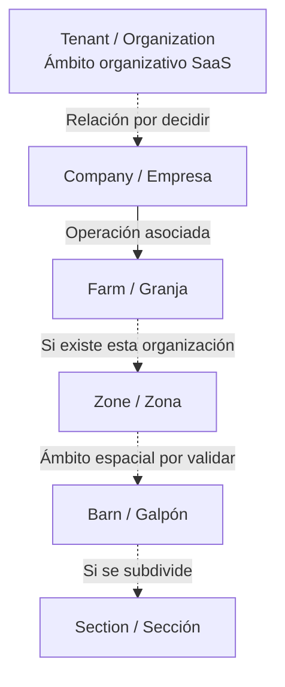
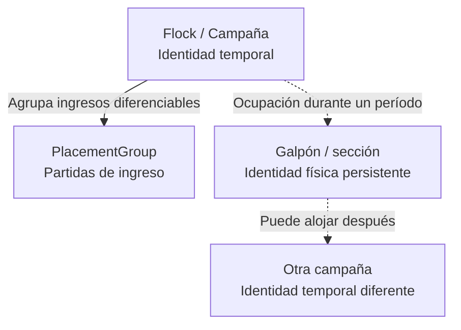

# Avicendia — Glosario del dominio

CG-007 · 17 de octubre de 2026 · Fase 00 · **Referencia terminológica documental, pendiente de aceptación externa.**

## 1. Objetivo y alcance

Precisar conceptos corporativos, físicos, productivos, comerciales y de información para administradores, responsables operativos y desarrolladores. El glosario diferencia identidad física persistente, ciclo temporal, ingreso de aves y agrupación comercial.

No implementa entidades, reglas de persistencia, SQL, migraciones ni APIs. Los nombres ingleses ayudan a reconocer conceptos; no acreditan clases ejecutables. Definir un término no demuestra que exista una funcionalidad ni valida su uso en una granja.

## 2. Fuentes y convenciones

- **D:** referencia local «Dominio avícola — Invariantes y nomenclatura» e invariantes de Control Granja Engineering v2.1. Se consultaron como contexto; no se publica el paquete ni se reproduce su documentación original.
- **P2:** [CG-002 — Tesis de producto](TESIS_PRODUCTO.md): ámbito por granja, galpón, sección y campaña; capacidades previstas.
- **P5:** [CG-005 — Flujo diario](FLUJO_DIARIO_PRODUCCION.md): recepción, seguimiento, T1–T7, fecha operativa, correcciones y cierres.
- **P6:** [CG-006 — Cartillas y mensajes](INVENTARIO_CARTILLAS_MENSAJES.md): soporte, evidencia, candidato, confirmación, autoría y comunicación.
- **P7:** solicitud vigente de CG-007: alcance de este glosario y definiciones de trabajo adicionales.

La columna Estado identifica también la fuente: **Definido** significa que el significado documental se apoya en las referencias, no que esté implementado o validado en campo; **Propuesto** es una formulación de trabajo aún sin aprobación; **Pendiente de validación** expresa una cuestión sin resolver. La sección 12 concentra las reglas y usos pendientes, incluso para términos definidos.

«Identidad independiente» explica cómo distinguir conceptualmente casos distintos; no prescribe claves ni formatos de identificador. Un nombre visible repetido no demuestra identidad entre empresas. Las flechas y símbolos de diferencia de este documento expresan relaciones de lectura, no cardinalidades o restricciones ejecutables.

## 3. Organización corporativa

**Tenant / Organization** es el cliente o ámbito organizativo del SaaS en el que deberá garantizarse el aislamiento correspondiente. **Company / Empresa** representa una entidad empresarial vinculada con la operación. Reconocer una empresa no acredita automáticamente acceso a todos sus recursos.

Tenant y Company no se equiparan. Su relación, cardinalidad, pertenencias y política multiempresa quedan sujetas a decisiones de negocio y arquitectura; este glosario no las resuelve. Tampoco supone que administrar una granja demuestre propiedad legal de la instalación.

## 4. Infraestructura física

**Farm / Granja** identifica una instalación productiva general. **Zone / Zona** agrupa espacial u operativamente instalaciones o recursos compartidos. **Barn / Galpón** es una instalación física de alojamiento y manejo de aves. **Section / Sección** es una subdivisión física del galpón cuando existe esa organización.

La relación conceptual es granja → zona → galpón → sección, con zonas y subdivisiones sujetas a comprobación en cada operación. No se crean niveles ficticios para completar la cadena. Los vínculos entre empresas y granjas también necesitan validación; el dibujo no fija su cardinalidad.

La instalación conserva su identidad al cambiar la crianza. La **ocupación** describe su utilización por una población durante un período; no es otra denominación de la instalación. Iniciar otra campaña no crea otra sección. Obras o reorganizaciones físicas requieren criterios de continuidad por acordar; no se decide aquí cuándo dividir, fusionar o renombrar instalaciones.

## 5. Organización productiva

**Flock / Campaña o ciclo de crianza** es un proceso temporal ligado a una población de aves y un período productivo. **PlacementGroup / Partida de ingreso** distingue agrupaciones de ingreso u origen dentro de esa campaña; es una propuesta terminológica del proyecto que debe contrastarse con el uso local.

Una campaña puede incluir varias partidas, recibidas en momentos diferentes. La partida no crea automáticamente una campaña independiente; tampoco cambia la identidad del galpón o sección. Recepción es el evento de ingreso y partida es la agrupación que permite diferenciarlo: no se impone una correspondencia de una recepción por partida sin validar el procedimiento.

**Invariante de referencia:** una misma sección no aloja simultáneamente dos campañas independientes activas, salvo excepción de negocio validada y modelada expresamente. Esta tarea no confirma ni habilita una excepción. Deben contrastarse existencia de casos excepcionales, límites físicos, períodos y autoridad antes de cualquier decisión de modelado.

La población alojada describe las aves presentes en un ámbito y momento; no es por sí misma la identidad de campaña, partida o selección comercial. No se agregan aquí fórmulas, políticas de ocupación ni alcance definitivo de una campaña entre instalaciones.

## 6. Organización comercial

**Lote comercial — definición provisional:** agrupación de aves identificada para una finalidad de seguimiento comercial, cuyos criterios de composición, vigencia y relación con crianza y movimientos deben acordarse. No hay equivalente técnico inglés aprobado en las fuentes consultadas.

No es sinónimo de campaña, partida ni población alojada. **Agrupación para venta** describe una selección orientada a vender; podría coincidir o no con el lote comercial según el significado que se valide. **Operación comercial** se refiere al acto o acuerdo comercial; **salida** es el movimiento físico fuera del ámbito de origen según su causa. Ninguno de esos hechos es la agrupación en sí; una salida no prueba por sí sola una venta.

La palabra informal «lote» puede designar un ciclo, un ingreso, una selección o una referencia comercial. Antes de mapearla, preguntar qué agrupa, con qué finalidad, quién la asigna, durante cuánto tiempo y cómo se relaciona con campaña, partidas y movimientos. No se decide que toda venta cree un lote ni que exista relación uno a uno. Una venta o salida parcial no acredita cierre de campaña.

## 7. Vocabulario operativo

Las definiciones breves están en la matriz. Para usarlas correctamente:

- **Recepción de aves** es ingreso físico; **recepción de información** es llegada de una comunicación. Esta última no determina la fecha del hecho ni confirma el contenido.
- **Registro diario** organiza anotaciones, datos y pendientes por ámbito y fecha operativa. **Registro operativo** se usa aquí en el sentido de P6: dato aceptado para el proceso correspondiente. Un aporte candidato en la recopilación diaria no pasa a confirmado por aparecer en un reporte.
- **Consumo** describe uso efectivo del recurso; **despacho** describe su envío. Precisar recurso, unidad, ámbito y período sin equiparar sacos entregados a alimento consumido.
- **Mortalidad**, **descarte** y **traslado** no son intercambiables. Precisar hecho, motivo y destino conocidos, evitando contar un retiro dos veces; no se establece procedimiento sanitario ni tratamiento contable.
- **Fecha operativa** identifica jornada o período de producción. America/Lima es referencia documental peruana; evento T1, disponibilidad T2, registro T3, comunicación T4, revisión T5, corrección T6 y cierre T7 conservan sus distinciones de P5/P6. Enviar de noche no asigna automáticamente otra fecha operativa.
- **Cierre diario** acepta un reporte bajo condiciones y autoridad por acordar; no resuelve por sí mismo una incidencia ni finaliza la campaña. Las correcciones posteriores conservan original, motivo y responsable y requieren revisión autorizada, sin reapertura automática.

## 8. Matriz terminológica

Una matriz dividida por familias para facilitar consulta. Todas las tablas conservan las ocho columnas solicitadas y cada término aparece una sola vez. Los guiones en equivalente técnico indican que no se adopta un nombre técnico inglés en esta tarea. Los paréntesis en Estado remiten a las fuentes de la sección 2.

### 8.1. Organización corporativa y física

| Término oficial | Equivalente técnico | Definición | Naturaleza | Identidad independiente | Relaciones | Confusiones frecuentes | Estado |
|---|---|---|---|---|---|---|---|
| Ámbito organizativo SaaS | Tenant / Organization | Ámbito cliente en que debe garantizarse aislamiento | Organizativa | Ámbito organizativo reconocido, no su nombre visible | Empresa; relación por decidir | Empresa o cuenta individual | Definido (D, P7) |
| Empresa | Company | Entidad empresarial vinculada a la operación | Organizativa | Entidad empresarial distinguible, no una instalación | Ámbito SaaS y granjas, sin cardinalidad fijada | Tenant, granja | Definido (D, P7) |
| Granja | Farm | Instalación productiva general | Física | Instalación y contexto empresarial diferenciables | Empresa, zonas o galpones | Empresa, zona | Definido (D, P2, P5) |
| Zona | Zone | Agrupación espacial u operativa de instalaciones o recursos | Física | Agrupación situada en su granja y límites reconocibles | Granja, galpones, recursos | Granja, galpón | Definido (D); existencia por validar |
| Galpón | Barn | Instalación de alojamiento y manejo de aves | Física | Instalación concreta, independiente de su ocupación | Granja/zona, secciones y ocupaciones | Zona, sección, campaña | Definido (D, P5) |
| Sección | Section | Subdivisión física de un galpón cuando corresponda | Física | Espacio dentro de su galpón que persiste entre campañas | Galpón y ocupación temporal | Galpón, campaña | Definido (D, P5); existencia por validar |

### 8.2. Organización productiva y comercial

| Término oficial | Equivalente técnico | Definición | Naturaleza | Identidad independiente | Relaciones | Confusiones frecuentes | Estado |
|---|---|---|---|---|---|---|---|
| Campaña o ciclo de crianza | Flock | Proceso temporal de crianza asociado a población y período | Temporal | Un ciclo distinguible de ciclos anteriores o posteriores | Ocupación de infraestructura; partidas | Sección, partida, lote comercial | Definido (D, P2, P5) |
| Partida de ingreso | PlacementGroup | Agrupación de ingreso u origen diferenciable dentro del ciclo | Operativa | Referencia de ingreso/origen dentro de una campaña | Campaña y recepciones | Campaña, lote comercial | Propuesto (D, P7) |
| Lote comercial | — | Agrupación para seguimiento comercial según criterios por acordar | Comercial | Composición, finalidad y vigencia aún por definir | Campañas, partidas, selecciones y operaciones por contrastar | Campaña, partida, población alojada, venta | Propuesto (P7); uso por validar |

### 8.3. Eventos y recursos

| Término oficial | Equivalente técnico | Definición | Naturaleza | Identidad independiente | Relaciones | Confusiones frecuentes | Estado |
|---|---|---|---|---|---|---|---|
| Recepción de aves | — | Evento de llegada e ingreso de aves al ámbito de destino | Operativa | Ingreso con origen, destino y momento distinguibles | Partida, campaña, instalación | Partida; recepción de mensajes | Definido (P5) |
| Mortalidad | — | Muerte de aves o su recuento identificado en ámbito y período | Operativa | Hecho/recuento con fuente, alcance y período | Campaña, sección, registro | Descarte, traslado, ausencia de dato | Definido (D, P5) |
| Descarte | — | Retiro del conjunto productivo por criterio autorizado, con motivo y destino por precisar | Operativa | Retiro distinguible y su destino conocido o pendiente | Población, campaña, eventual salida | Mortalidad, traslado o venta automáticos | Propuesto (D, P7) |
| Traslado | — | Movimiento de aves entre ámbitos de origen y destino identificados | Operativa | Movimiento, origen, destino y momento | Infraestructura, población, campaña según el caso | Nueva recepción de origen, venta, muerte | Propuesto (D, P7) |
| Consumo | — | Uso efectivo de un recurso en ámbito y período identificados | Operativa | Recurso, alcance, período y fuente | Alimento/agua, medición, registro | Despacho o entrega | Definido (D, P5) |
| Despacho | — | Envío de un recurso desde origen a destino; precisar qué se envía | Operativa | Envío y objeto distinguibles, con origen/destino | Recurso, transporte o entrega según el caso | Consumo, recepción o cobro | Propuesto (D, P7) |

### 8.4. Observación e información

| Término oficial | Equivalente técnico | Definición | Naturaleza | Identidad independiente | Relaciones | Confusiones frecuentes | Estado |
|---|---|---|---|---|---|---|---|
| Medición | — | Obtención de un valor mediante método, unidad y contexto identificados | Operativa | Variable, lugar, momento, método y muestra si aplica | Instrumento, evidencia, dato | Estimación o lectura sin contexto | Definido (P5) |
| Incidencia | — | Situación reportada u observada que requiere aclaración o seguimiento | Operativa | Caso y ámbito distinguibles, con origen del relato | Mensajes, evidencia, seguimiento | Diagnóstico, causa confirmada | Definido (P5, P6) |
| Mensaje | — | Comunicación de contenido por un canal autorizado | Operativa | Comunicación y procedencia distinguibles | Autor/remitente, evidencia, otros mensajes | Evento productivo, dato confirmado | Definido (P6) |
| Evidencia | — | Contenido efectivamente disponible que sustenta una revisión con límites | Operativa | Aporte de origen distinguible de copias y referencias | Mensaje, candidato, revisión | Registro, hecho confirmado | Definido (P6) |
| Dato candidato | — | Valor propuesto para un contexto, aún no aceptado y con dudas explícitas | Operativa | Propuesta vinculada a fuente y contexto | Evidencia, interpretación, revisión | Dato confirmado | Definido (P6) |
| Dato confirmado | — | Dato aceptado tras comprobación por función autorizada y con alcance identificado | Operativa | Dato y contexto objeto de aceptación rastreable | Evidencia, revisión, registro operativo | Extracción, relato, recepción | Definido (P6) |

### 8.5. Registros, tiempo y cierre

| Término oficial | Equivalente técnico | Definición | Naturaleza | Identidad independiente | Relaciones | Confusiones frecuentes | Estado |
|---|---|---|---|---|---|---|---|
| Registro diario | — | Recopilación documentada de anotaciones, datos y pendientes del ámbito y jornada | Operativa | Ámbito y fecha operativa, con aportes distinguibles | Campaña, datos, evidencia | Evidencia o dato ya confirmado | Definido (P5); redacción precisada en P7 |
| Registro operativo | — | Dato aceptado para el proceso correspondiente, en el sentido de P6 | Operativa | Dato aceptado, fuente y contexto distinguibles | Confirmación y proceso | Mensaje recibido, recopilación pendiente | Definido (P6) |
| Fecha operativa | — | Jornada o período productivo al que pertenece el dato | Temporal | Fecha/período y ámbito según corte por validar | T1–T7, registro diario | Fecha de envío, recepción o servidor | Definido (P5, P6) |
| Corrección | — | Rectificación rastreable de un aporte, con original, motivo y responsable | Operativa | Cambio y vínculo al aporte anterior | Revisión, evidencia, consolidado | Reemplazo silencioso, nuevo evento | Definido (P5, P6) |
| Consolidación | — | Reunión de aportes compatibles por ámbito y período, preservando pendientes | Operativa | Alcance y período del conjunto revisado | Registros, fuentes, revisión | Suma indiscriminada, confirmación o cierre | Definido (P5) |
| Cierre diario | — | Aceptación del reporte de una jornada según condiciones y autoridad acordadas | Operativa | Reporte, alcance, fecha operativa y aceptación | Revisión, pendientes, correcciones | Cierre de campaña o resolución de incidencia | Definido (P5); condiciones por validar |
| Cierre de campaña | — | Finalización aceptada del ciclo conforme a criterios y autoridad por acordar | Temporal | Campaña concreta y decisión de finalización | Ciclo, historia y pendientes | Cierre diario, venta o salida parcial | Propuesto (P5, P7) |

## 9. Diagramas conceptuales

Las flechas indican relaciones conceptuales, sin números de multiplicidad, propiedad legal, herencia ni claves de base de datos. La línea discontinua destaca una relación sujeta a reservas; la continua tampoco establece cardinalidades. La existencia de zonas y secciones debe comprobarse, sin imponer niveles ficticios.

### 9.1. Ámbito corporativo e infraestructura

### 9.2. Campaña, partidas y ocupación

La ocupación relaciona ciclo e infraestructura, no transforma una identidad en otra. El segundo diagrama no fija cuántas instalaciones ocupa una campaña ni una relación uno a uno entre recepción y partida. La sucesión de campañas no implica simultaneidad; la excepción a la invariante de sección sigue pendiente de validación.

## 10. Ejemplos sintéticos

**E01–E04 son completamente ficticios.** Las etiquetas son referencias de explicación, no identificadores técnicos propuestos; no hay cantidades, fechas ni datos históricos de granjas.

- **E01 — Dos campañas sucesivas:** la sección ficticia «Espacio Alfa» aloja «Ciclo Brisa» y, una vez terminado, «Ciclo Cauce». La sección es la misma; los ciclos son distintos y sus registros no se fusionan por compartir instalación. No se representa ocupación simultánea.
- **E02 — Dos partidas en una campaña:** «Ciclo Brisa» reúne «Ingreso Olmo» e «Ingreso Sauce», recibidos en momentos diferentes. Conservan referencias de ingreso/origen distintas dentro del mismo ciclo. Las cantidades documentadas de cada ingreso, cuando existan, no se vuelven a contar añadiendo otra vez el total del ciclo; no se inventa una segunda población por el consolidado.
- **E03 — Varios galpones:** «Empresa Horizonte» administra «Granja Ilustración», con «Galpón Ámbar» y «Galpón Nube», cada uno con una sección llamada «Norte». El nombre compartido no hace que sean la misma sección. Cada registro conserva empresa, granja, galpón, sección, campaña y fecha pertinentes; no se supone una política Tenant–Company ni una zona inexistente en el ejemplo.
- **E04 — Agrupación comercial:** se propone «Selección Cedro» para una eventual operación comercial sobre aves de «Ciclo Brisa». Deben comprobarse composición, relación con «Ingreso Olmo»/«Ingreso Sauce», finalidad y si el operador llamaría a esa selección lote comercial. La selección no es automáticamente una partida, otra campaña, venta realizada ni salida física.

## 11. Reglas de consistencia terminológica

Diferencias de significado, no restricciones implementadas:

- Empresa ≠ granja; granja ≠ zona; zona ≠ galpón; galpón ≠ sección.
- Sección ≠ campaña; campaña ≠ partida; partida ≠ lote comercial.
- Registro ≠ evidencia; evidencia ≠ dato confirmado.
- Despacho ≠ consumo; cierre diario ≠ cierre de campaña.
- Tenant ≠ Company; una operación comercial tampoco es el proceso de crianza.

Las instalaciones persisten entre campañas; las campañas son temporales y las partidas distinguen ingresos/orígenes dentro del ciclo. Un nombre o identificador visual no prueba identidad ni acceso entre empresas. Reenvío o foto repetida pueden ser otra comunicación/evidencia del mismo hecho, sin otro ingreso, muerte o consumo.

Cuando aparezca «lote», «registro», «recepción» o «cierre» sin calificativo, aclarar su significado y contexto antes de asignarlo a un concepto. Los datos ausentes no se convierten en cero ni las inferencias en hechos por una decisión de vocabulario.

## 12. Ambigüedades y decisiones pendientes

| Cuestión | Qué debe comprobarse o acordarse | Reserva documental |
|---|---|---|
| Uso de «lote» | Finalidad, composición, vigencia y equivalencia local en cada proceso | Lote comercial sigue provisional; no mapear automáticamente |
| Partida frente a campaña | Qué identifica cada ingreso/origen y qué delimita el ciclo | Nombre local o «sublote» no decide la identidad |
| Zonas y secciones | Existencia, límites, servicios, cambios físicos y nombres repetidos | No exigir ni crear niveles no observados |
| Múltiples ingresos | Si se agrupan en un ciclo, cómo se diferencian y qué recepciones corresponden | Varias partidas son posibles; asignación real por verificar |
| Ocupación simultánea excepcional | Si existe, qué la justifica, sus límites, períodos y autoridad | Ninguna excepción validada o habilitada aquí |
| Tenant–Company y empresas–granjas | Relaciones, cardinalidades, administración y alcance de acceso | Sin política multiempresa ni propiedad legal inferida |
| Agrupaciones comerciales | Selección para venta, composición y relación con campañas, partidas y salidas | Sin equivalencia comercial ni relación uno a uno aprobadas |
| Asignación y cierres | Funciones autorizadas, condiciones, pendientes y correcciones posteriores | Responsabilidades y reglas de cierre por acordar |
| Descarte, traslado y despacho | Significado local, objeto, destino y relación con otros eventos | Definiciones de trabajo; no duplicar hechos por etiquetas |

Las definiciones de trabajo permiten conversar con precisión; no sustituyen la validación de reglas de negocio. No resolver estos vacíos mediante suposiciones silenciosas ni aprobar excepciones a través de un diagrama.

## 13. Relación con tareas anteriores

P2 ya utiliza campaña como ciclo y separa capacidades previstas de producto disponible. P5 distingue infraestructura, campaña y partida, contempla varios ingresos y conserva fecha operativa, correcciones y cierres. P6 separa modalidades de evidencia de categorías del hecho, y mensaje/candidato/confirmación/registro. Estas distinciones se mantienen.

Las reservas localizadas son el uso informal de «lote» en material previo y los sentidos de «registro», «recepción» y «cierre» según el proceso. Este glosario aporta calificativos y equivalencias de lectura sin reescribir las fuentes ni convertirlas en arquitectura. No se modifican documentos anteriores ni se afirma validación de campo.
