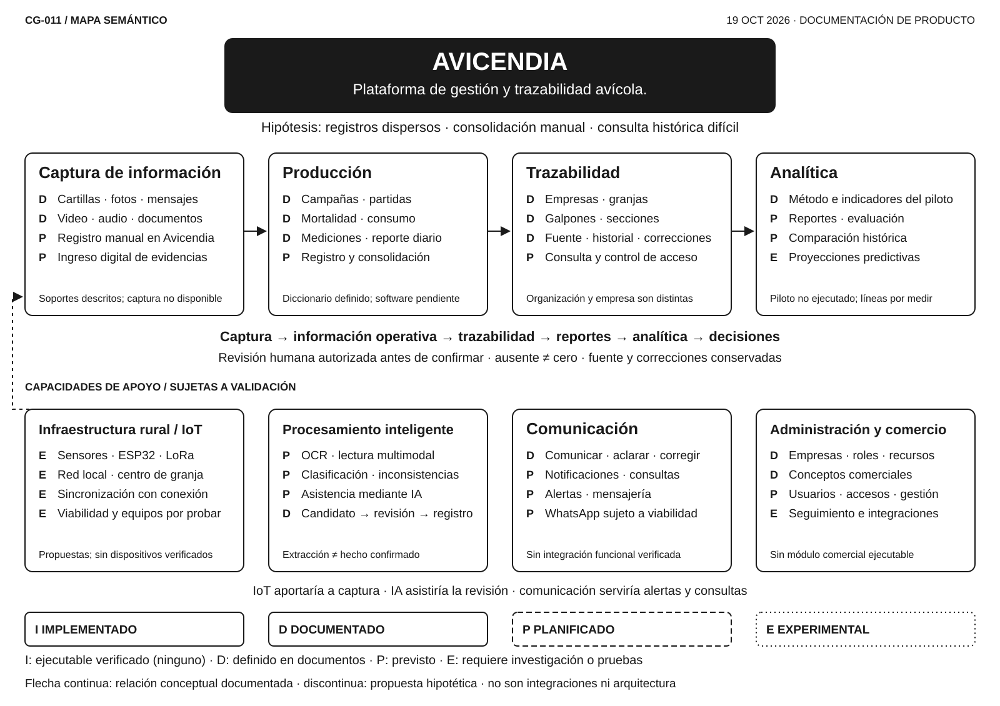

# Avicendia — Mapa semántico del proyecto

CG-011 · 19 de octubre de 2026 · Síntesis conceptual, pendiente de aceptación externa.

El mapa presenta Avicendia como una plataforma prevista de gestión y trazabilidad avícola, inicialmente para pollos de engorde. La hipótesis es que registros dispersos dificultan consolidar reportes y consultar antecedentes. El problema, los usuarios y la utilidad necesitan validación de campo. No representa un despliegue, una arquitectura definitiva ni software disponible.

## Lectura y estados

Las letras se aplican a cada línea, no a todo el módulo. Todas usan carbón sobre blanco: el significado no depende del color. Los bordes de la leyenda ayudan a reconocer las categorías; las letras junto a las capacidades son la referencia principal.

| Letra | Estado | Significado |
|---|---|---|
| I | IMPLEMENTADO | Capacidad ejecutable existente y verificada. Ninguna acreditada en el alcance inspeccionado. |
| D | DOCUMENTADO | Concepto, especificación o procedimiento descrito; no demuestra ejecución ni aceptación de campo. |
| P | PLANIFICADO | Capacidad prevista, todavía sin implementación confirmada; tampoco supone un compromiso comercial. |
| E | EXPERIMENTAL | Propuesta cuya pertinencia y viabilidad requieren investigación o pruebas; no implica prototipo construido. |

Las flechas continuas resumen relaciones funcionales documentadas: captura → información operativa → trazabilidad → reportes → analítica → decisiones. Las tres flechas entre tarjetas condensan esa cadena; no son transferencias automáticas. La flecha discontinua IoT → captura es una hipótesis técnica. No hay conexiones de integración verificadas que representar. La revisión humana con autoridad efectiva precedería a la confirmación de datos; recibir o extraer un valor no acredita el hecho. Un dato ausente no se sustituye por cero.

## Módulos y fundamento

La agrupación sirve a la lectura; no define servicios, límites técnicos ni cardinalidades. Las capacidades P y E son posibilidades sujetas a validación, no un catálogo aprobado para implementar.

| Módulo | Documentación existente y capacidades futuras | Fundamento público |
|---|---|---|
| Captura de información | D: soportes físicos y digitales descritos. P: registro manual e ingreso de evidencias en Avicendia. No hay captura ni extracción disponible acreditada. | [CG-005](FLUJO_DIARIO_PRODUCCION.md), [CG-006](INVENTARIO_CARTILLAS_MENSAJES.md) |
| Producción | D: campañas, partidas, mortalidad, consumo, mediciones y diccionario diario. P: registro y consolidación ejecutables. | [CG-005](FLUJO_DIARIO_PRODUCCION.md), [CG-007](GLOSARIO_DOMINIO.md), [CG-009](DICCIONARIO_REPORTE_DIARIO.md) |
| Trazabilidad | D: empresas, instalaciones, procedencia e historia de correcciones. P: futura implementación de consulta y autorización. Organización no equivale a empresa; cada recurso necesitaría acceso efectivo. | [CG-006](INVENTARIO_CARTILLAS_MENSAJES.md), [CG-007](GLOSARIO_DOMINIO.md), [CG-009](DICCIONARIO_REPORTE_DIARIO.md) |
| Analítica | D: metodología e indicadores de un futuro piloto. P: reportes, evaluación y comparación histórica. E: proyecciones predictivas propuestas en este encargo, sin modelo, viabilidad ni utilidad probados. | [CG-002](TESIS_PRODUCTO.md), [CG-010](METRICAS_EXITO_PILOTO.md) |
| Infraestructura rural / IoT | E: sensores, ESP32, redes locales, LoRa, centro de datos de granja y sincronización al disponer de conexión. Son propuestas del encargo CG-011, sin instalación o prueba acreditada; no se selecciona tecnología. | [CG-002](TESIS_PRODUCTO.md) contempla instrumentos; [CG-003](CLIENTE_IDEAL.md) exige comprobar conectividad. Los dispositivos concretos proceden de la solicitud vigente. |
| Procesamiento inteligente | D: evidencia → candidato → revisión autorizada → registro. P: OCR, interpretación multimodal, clasificación, detección de inconsistencias y asistencia con IA. Su prioridad, precisión y tratamiento de errores siguen por validar. | [CG-002](TESIS_PRODUCTO.md), [CG-006](INVENTARIO_CARTILLAS_MENSAJES.md) |
| Comunicación | D: comunicación, aclaraciones y correcciones. P: notificaciones, consultas, alertas e integración de mensajería. WhatsApp no funciona como integración existente. | [CG-002](TESIS_PRODUCTO.md), [CG-005](FLUJO_DIARIO_PRODUCCION.md), [CG-006](INVENTARIO_CARTILLAS_MENSAJES.md) |
| Administración y comercio | D: conceptos de empresas, funciones, recursos y vocabulario comercial. P: usuarios, accesos y gestión empresarial. E: seguimiento comercial e integraciones con otros sistemas, propuestos aquí para investigar, sin alcance aprobado ni módulo ejecutable. | [CG-003](CLIENTE_IDEAL.md), [CG-007](GLOSARIO_DOMINIO.md) y solicitud vigente CG-011 |

La IA asistiría la revisión, la comunicación serviría consultas y alertas y la administración daría contexto de gestión y acceso. Estas son relaciones semánticas, no interfaces implementadas. La continuidad manual ante fallos de automatización es un criterio de diseño pendiente de comprobar.

## Validación pendiente y límites

Antes de convertir propuestas en funcionalidades deben contrastarse el problema y el comprador ([CG-002](TESIS_PRODUCTO.md), [CG-003](CLIENTE_IDEAL.md)), tareas y autoridad de revisión ([CG-004](GUIA_ENTREVISTAS_CAMPO.md) y su [formato vacío](FORMATO_ENTREVISTA.md)), contexto y calidad de soportes ([CG-006](INVENTARIO_CARTILLAS_MENSAJES.md)), unidades y campos exigibles ([CG-009](DICCIONARIO_REPORTE_DIARIO.md)), conectividad y dispositivos disponibles. OCR, predicción, IoT e integraciones necesitan además pruebas de viabilidad, permisos y evaluación de utilidad.

[CG-008](EJEMPLO_OPERATIVO_G06.md) es un ejemplo ficticio; su reproducción cuantitativa histórica exacta sigue pendiente. [CG-010](METRICAS_EXITO_PILOTO.md) documenta una metodología y una [plantilla vacía](PLANTILLA_SEGUIMIENTO_KPI.md): no acredita un piloto ejecutado, líneas base medidas ni resultados comerciales. El repositorio público inspeccionado contiene documentación y recursos de presentación; su existencia no demuestra funciones del SaaS. Esta revisión no certifica implementaciones externas al repositorio.

## Fuente editable y mantenimiento

El [SVG](MAPA_SEMANTICO_AVICENDIA.svg) es simultáneamente fuente vectorial y vista para GitHub: contiene texto seleccionable en elementos `text`, tarjetas en grupos `modulo-*`, núcleo `nucleo-avicendia`, conexiones `relaciones-principales` / `relacion-sensores-captura` y grupo `leyenda`. No incluye imágenes incrustadas, fuentes externas, scripts ni texto convertido en contornos. Arial/Helvetica/sans-serif son fuentes de sistema; puede variar ligeramente la métrica entre equipos.

Puede editarse como XML o abrirse en un editor SVG como Inkscape: desagrupar solo el módulo necesario, editar texto y recolocar sus elementos conservando los identificadores. Las flechas son trazados independientes, **no conectores anclados automáticamente**: al mover una tarjeta hay que ajustar sus extremos. Guardar como SVG, conservar `viewBox`, título y descripción accesibles y revisar la exportación completa. No importar el SVG en tldraw esperando recuperar sus nodos: podría tratarlo como una sola imagen.

Se intentó usar el conector tldraw: se creó un tablero vacío, pero la vista permaneció cargando y dos llamadas de edición devolvieron que el tablero no estaba abierto. No se dibujó allí ni se confirmó una exportación nativa. Por ello no se entrega `.tldr`; el tablero vacío no es la fuente ni evidencia de compatibilidad. Se verificaron el XML, renderizado y edición de texto del SVG; no se ensayó la interfaz de Inkscape.

Se usa blanco y carbón de las [convenciones visuales públicas](../brand/ASSETS.md), sin redibujar el logotipo ni adoptar colores adicionales. La identidad reconstruida permanece en revisión; el nombre del núcleo es una etiqueta textual, no un nuevo activo de marca.

Revisar el mapa ante cambios materiales del modelo conceptual, nuevas capacidades verificadas o hitos significativos. No requiere actualización por commit. Para cambiar un estado, registrar evidencia en esta tabla de fundamento o en el reporte correspondiente; una especificación nueva sigue siendo D. Mantener etiquetas breves, estados por capacidad y leyenda completa. Comprobar textos, conexiones y ausencia de superposiciones a tamaño original y reducido. No cambiar el diseño sin nueva decisión o evidencia.

El [reporte CG-011](../reportes/REPORTE_CG-011.md) conserva aceptación, comprobaciones y límites de esta versión.
